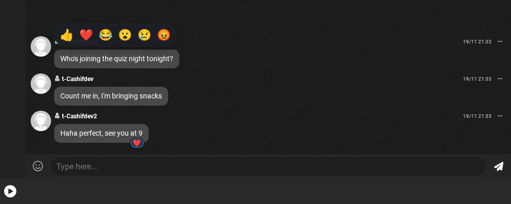
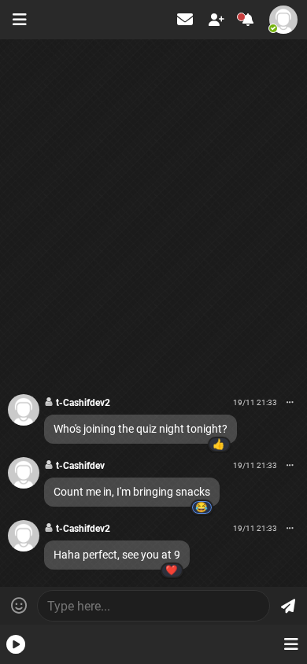
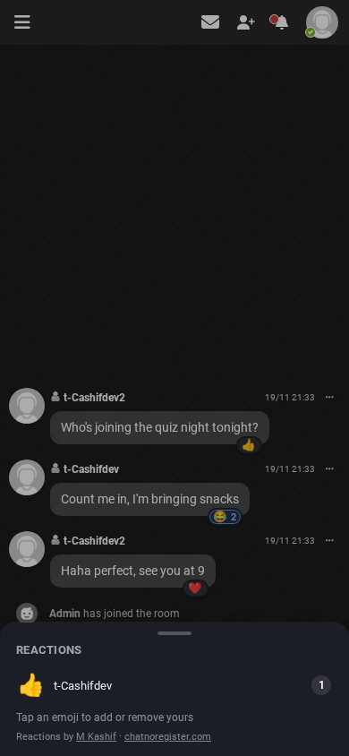
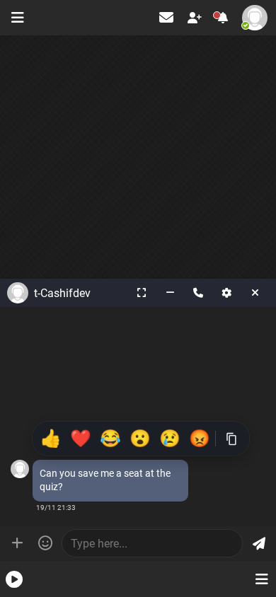
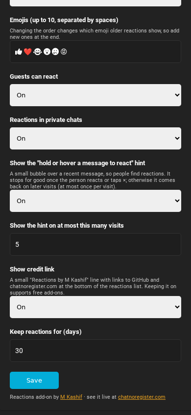

# 😀 Reactions for Codychat 10.1

  

Let members react to messages with an emoji, in rooms and in private chats. Hover a message on a computer, or hold it on a phone, and tap an emoji. A small pill on the bubble shows the reactions, and a tap on it shows who reacted.

**Author:** [M Kashif](https://github.com/cashifdev) · **License:** MIT · **Tested on:** a clean Codychat 10.1 install

## Screenshots

| React on desktop | On a phone |
|---|---|
|  |  |

| Who reacted | Hold a private message | Admin settings |
|---|---|---|
|  |  |  |

## Features
- Emoji reactions on **room messages** and **private messages**
- Desktop: hover a message to open the emoji bar. Phone: hold the message (no text selection pop-up)
- One reaction per person per message. Tap the same emoji again to remove it, or another one to change it
- Compact pill on the bubble with the top 3 emojis and the total
- Tap the pill to see **who reacted** with which emoji
- **Copy** button in the phone emoji bar
- Works with the bubble and text chat styles, light and dark themes
- Other members see new reactions within about 12 seconds, no socket server needed
- Optional credit line (on by default) with links to the author's GitHub and chatnoregister.com, which admins can turn off
- Optional "hold or hover a message to react" hint for new visitors
- Admin settings: on or off, your own emoji list (up to 10), guests can react or not, private chat reactions on or off, how long to keep reactions
- Flood protection and mute checks (muted members can't react)
- Old reactions are cleaned up automatically
- No external services, no API keys: everything stays on your server

## Requirements
- Codychat **10.1**
- PHP 8.0+ (tested on 8.3), MySQL/MariaDB
- Redis is optional (used for flood limits when available)

## Install
1. Download this repo and upload the `reactions` folder to `addons/` on your server, so you have `addons/reactions/`.
2. Open your **Admin panel → Addons** and press **Install** next to *reactions*.
3. Open its settings to pick your emojis. Done.

The installer creates one table, `boom_reactions`. Uninstalling removes it.

## Admin settings
| Setting | What it does |
|---|---|
| Reactions on this site | Turns the add-on on or off |
| Emojis | Up to 10, separated by spaces. Add new ones at the end, because the order decides which emoji older reactions show |
| Guests can react | Off = guests only see reactions |
| Reactions in private chats | Turns private chat reactions on or off |
| Hint | A small bubble that shows new visitors how to react |
| Show credit link | Shows a small "Reactions by M Kashif · chatnoregister.com" line at the bottom of the reactions list. Keeping it on supports free add-ons |
| Keep reactions for | Days to keep reactions before cleanup (1 to 365) |

## For developers
Reactions refresh by polling. If your chat has its own socket bridge, you can make them instant: expose `window.rxSocketSend(msg)` and `window.rxSocketConnected()`, and trigger the jQuery event `rx:update` with `{t, mid, s}` when a reaction arrives. Polling stops while the socket is connected.

## Support
Tested on Codychat **10.1** only. Need it on Codychat 11 or an older version? Open an issue titled **Paid install help**.

Found a bug? [Open a bug report](https://github.com/cashifdev/codychat-reactions/issues/new?template=bug_report.md) with your Codychat version and what you see. See the [changelog](CHANGELOG.md) for what's new.

⭐ If this add-on makes your chat more fun, star the repo and [follow me on GitHub](https://github.com/cashifdev) for more.

See it live at **[chatnoregister.com](https://chatnoregister.com)**.
